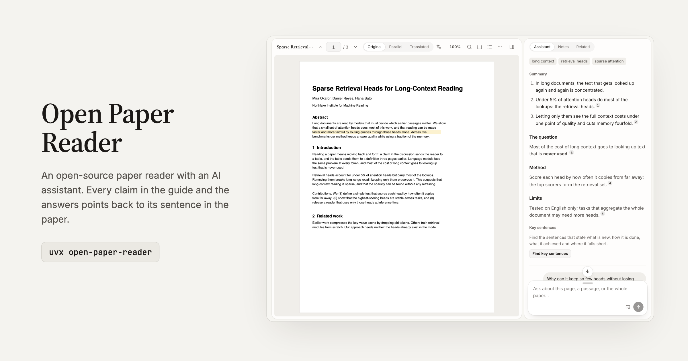

<picture>
  <source media="(prefers-color-scheme: dark)" srcset="docs/assets/banner-dark-en.png">
  
</picture>

# Open Paper Reader

<p align="center">
  <a href="https://papers.dougao.online"></a>
</p>
<p align="center"><b>Open <a href="https://papers.dougao.online">papers.dougao.online</a> and start reading; nothing to install.</b> To keep your papers on your own computer, run it locally (below).</p>

**An open-source paper reader with an AI assistant.** Import a PDF, an arXiv link or any paper URL and get a guide; select a sentence to have it explained, translated or kept in your notes; ask the assistant anything. Every claim in the guide and the answers is cited, and a click takes you to its sentence in the paper.

[简体中文](README.md) · English · [Use it online](https://papers.dougao.online) · [Local build](docs/LOCAL.md) · [All docs](docs/README.md)

[](https://github.com/Jialei-03/open-paper-reader/actions/workflows/verify.yml) [](LICENSE)

## What it does

**Read**
- **Guide**: written right after import (a summary, keywords and a note per section) and shown as it streams in. Each sentence carries a small number; hover it for the sentence it stands on, click it to jump there and see it highlighted.
- **Key sentences**: the sentences that state what is new, the method, the results and the limits are underlined in the paper, each kind can be hidden.
- **Select**: explain, translate, highlight, keep in your notes, or ask the assistant about the selected text. Translations are kept, so the same sentence shows its translation at once next time.
- **Box**: draw a box around a figure, a table or a formula to have it explained, or turn a formula into LaTeX.
- **Citations**: hover a citation in the text to see the cited paper's title, authors, year, abstract and citation count; preview it or add it to your library in one click.

**Ask**
- **Assistant**: reads the pages you point to, or the whole paper, before answering; each step it took can be expanded. Its answers are cited sentence by sentence too, in the language you asked in.
- **Question box**: docked under the assistant, or dragged out to float over the paper.

**Translate**
- **Parallel**: each page's translation beside it.
- **Translated PDF**, two methods, both kept:
  - **Source recompile**: translates the LaTeX source of an arXiv paper and compiles it, for the best typesetting. If the compile fails, the assistant reads the error and tries to fix it.
  - **Layout translation**: translates the PDF itself and keeps its layout; works for any PDF (built on BabelDOC).
- **Side by side**: original and translation next to each other, scrolling page for page.

**Keep**
- **Notes**: one Markdown note per paper, with its highlights and annotations listed below; guide passages and answers can be kept in it with their citations.
- **Library**: cards with a first-page thumbnail or a list, sorted by progress, citations and more. A paper's details show venue, DOI and citation count, and copy BibTeX, APA or GB/T 7714, or export a .bib for several papers.
- **Related and Discover**: a paper's references and the papers citing it; Discover suggests papers from your library and says why.
- **Any URL**: the import box takes arXiv, publisher pages and direct PDF links; the [browser extension](extension/README.md) opens the page you are on in one click.

## Principles

- **Local first.** Meant to run on your own computer: papers and notes stay there, no sign-in, no background crawling, no telemetry.
- **Your own model.** The built-in [Pi](https://github.com/earendil-works/pi) assistant works with API keys from many providers (OpenAI-compatible, Anthropic and more) or with local models (Ollama, LM Studio).
- **Citations are checked before they are shown.** Every citation in a guide or an answer is looked up in the paper: a wrong page is corrected, and a sentence that is not there is dropped rather than pointing to the wrong place.
- **Claude Code and Codex are not connected yet.** The plan is an MCP server with the reader's abilities (reading pages, searching the paper, reading and writing notes) so the Claude Code or Codex on your computer can read papers. It is not in this version. This project is not affiliated with Anthropic or OpenAI.
- **Online whenever you want it.** [papers.dougao.online](https://papers.dougao.online) needs no install: sign up, add your own API key and read.

## Getting started

### Online

Open [papers.dougao.online](https://papers.dougao.online), sign up, add a model in Settings (your own API key) and import a paper.

### On your own computer

```bash
uvx open-paper-reader        # short name: opr; or pipx install open-paper-reader
```

It starts the service on your computer and opens your browser, with no sign-in. Add a model the first time (an API key, or a local model such as Ollama or LM Studio); once its connection test passes, import a paper. Layout translation and the LaTeX compiler are installed from Settings the first time you need them. Papers and notes live in `~/.open-paper-reader/`. See [Local build](docs/LOCAL.md).

> The 0.2.0 package is not on PyPI yet; until it is, run it from source (see Development below).

### Browser extension

[`extension/`](extension/README.md) holds a Chrome / Edge extension (install with "Load unpacked"): on any page or PDF link, the toolbar button or the context menu opens it in Open Paper Reader, online or local. The extension sends only the URL and never reads the page.

## Development

```bash
make install   # .venv plus backend, frontend and assistant runtime dependencies
make db        # database migrations (SQLite by default on your computer)
make build     # build the frontend
make run       # http://127.0.0.1:8765
make worker    # in another terminal: the assistant worker (needs Node.js 22)
make help      # every command
```

Layout, tests and conventions are in [Development](docs/DEVELOPMENT.md); the overall design is in [Architecture](docs/ARCHITECTURE.md).

## Status and limits

- **Check what the model writes.** The assistant, explanations, translations and the guide are model output; citations are checked against the paper, but that does not guarantee facts or translation quality.
- **Source recompile** needs the paper's LaTeX to compile with XeLaTeX. Common incompatibilities are handled automatically and a failed compile is handed to the assistant to fix; if it still fails, use layout translation. The local build compiles with Tectonic, which lacks a few journal templates; the online version uses full TeX Live.
- **Layout translation** quality varies by paper; scanned papers and formula-heavy pages have not been specifically validated.
- Database migrations go one way: back up before upgrading.

## Privacy

With the local build your data stays on your own computer; the author receives nothing. The program reaches outside services only for: the model service you configure (with the paper content a task needs), arXiv, Semantic Scholar, OpenAlex, Crossref, and the paper URLs you import. Selection translation in the interface uses your configured model; the backend also keeps a quick-translation endpoint, used only when called through the API, which sends text to `translate.googleapis.com`. The full list is in [Architecture](docs/ARCHITECTURE.md).

## Contributing

Issues and pull requests are welcome; see [CONTRIBUTING](CONTRIBUTING.md). Please report security issues privately as described in [SECURITY](SECURITY.md).

## License

[MIT](LICENSE). Third-party licenses are listed in [NOTICE](NOTICE.md); BabelDOC, used by layout translation, is AGPL-3.0 and is installed only when needed, or lives in an optional, separately built image.

Built on the shoulders of [PDF.js](https://github.com/mozilla/pdf.js), [Pi](https://github.com/earendil-works/pi), [BabelDOC](https://github.com/funstory-ai/BabelDOC), [LaTeXTrans](https://github.com/NiuTrans/LaTeXTrans), [Tectonic](https://tectonic-typesetting.github.io), [TipTap](https://tiptap.dev), [KaTeX](https://katex.org), [FastAPI](https://fastapi.tiangolo.com) and [SQLAlchemy](https://www.sqlalchemy.org).
