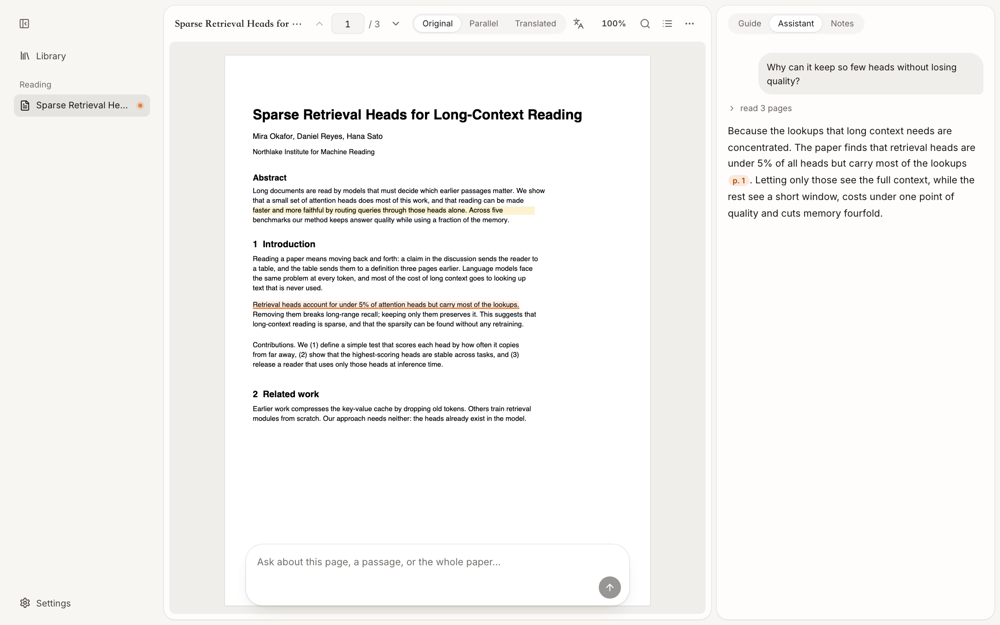

# open-paper-reader

**开源的论文阅读器：用 AI 助手读论文。** 导入 PDF 或 arXiv 链接，自动生成导读，划选即解释或翻译，向助手提问；回答里的引用能点回原文的那一句。

简体中文 · [English](README.en.md) · [部署](docs/DEPLOYMENT.md) · [功能](docs/FEATURES.md) · [全部文档](docs/README.md)

[](https://github.com/Jialei-03/zhijian/actions/workflows/verify.yml) [](LICENSE)



> 项目正在从「纸间」改名为 open-paper-reader，界面和文档逐步更新中；仓库地址暂时不变。

## 它是什么

读论文常常要在 PDF 阅读器、翻译、笔记和聊天窗口之间来回切换。open-paper-reader 把它们放进一个窗口：

- **导读**：导入后自动生成，边生成边显示。
- **划选**：选中文字即可解释、翻译、高亮、记到笔记，或带着这段话问助手。
- **助手**：实际读取你指的页面或整篇论文来回答；每一步做了什么（读了哪页、搜了什么）都可以展开查看；回答里的页码引用点一下，跳到原文并高亮那一句。
- **阅读方式**：原文、逐段对照、保留版式的译文（版面翻译，实验性）。
- **笔记**：每篇论文一份 Markdown 笔记，下面列出这篇论文的高亮和批注，点一条回到原文。

## 设计取向

- **本地优先。** 主要装在自己电脑上用，论文和笔记留在本机；没有后台抓取，没有遥测。
- **助手内置 [Pi](https://github.com/earendil-works/pi)。** 可以连各家的 API 密钥（OpenAI 兼容、Anthropic 等），也可以连本机模型（Ollama、LM Studio）。
- **Claude Code、Codex 还没有接入。** 计划在 v2 里把阅读器的能力（读页、搜索全文、读写笔记）做成 MCP 服务，让你本机已登录的 Claude Code 或 Codex 来读论文。目前这只是计划，现在的版本里没有。本项目与 Anthropic、OpenAI 无关联。
- **云端版是可选的。** 维护者提供一个在线服务（[papers.dougao.online](https://papers.dougao.online)），给不想自己装的人；云端版只能使用你自己的 API 密钥，不支持用订阅账号登录。

## 快速开始

本机一条命令（0.2.0 起提供，尚未发布；发布前请用下面的 Docker 或源码方式）：

```bash
uvx open-paper-reader        # 别名 opr
```

它会在本机启动服务并打开浏览器。第一次打开时先添加一个模型（API 密钥或本机模型），测试连接通过后就可以导入论文。

### 用 Docker 自己部署（现在可用）

需要 Docker 和 Compose v2.24 或更新、约 2 GB 空闲内存。

```bash
git clone https://github.com/Jialei-03/zhijian.git
cd zhijian
cp .env.example .env
# 把 POSTGRES_PASSWORD 换成一串随机的字母数字：
sed -i "s/^POSTGRES_PASSWORD=.*/POSTGRES_PASSWORD=$(openssl rand -hex 24)/" .env    # macOS 用 sed -i ''
docker compose up -d --build
```

打开 <http://localhost:8765>，注册第一个账户，然后在设置里添加模型。公网部署、邀请制注册、备份和升级见 [部署](docs/DEPLOYMENT.md)。

出于安全，Docker/云端部署的服务器只向 HTTPS、公网、且在名单里的模型服务发请求（见 [配置](docs/CONFIGURATION.md#模型)）；连本机模型是本机版的能力。

## 本地开发

```bash
make install   # .venv + 后端、前端、助手运行时的依赖
make db        # 数据库迁移（本机默认 SQLite）
make build     # 构建前端
make run       # http://127.0.0.1:8765
make worker    # 另一个终端：助手 worker（需要 Node.js 22）
make help      # 全部命令
```

目录结构、测试和约定见 [开发](docs/DEVELOPMENT.md)，整体设计见 [架构](docs/ARCHITECTURE.md)。

## 现状与限制

- 新界面正在分阶段替换旧界面，旧界面里的知识图谱、发现论文、分享链接等功能不会出现在新界面中；已有数据保留。
- **模型输出需要你自己核对。** 助手、解释、翻译和导读都是模型生成的；服务端会校验引文确实出自原文，但这不保证事实或译文的质量。
- 版面翻译是实验性的：质量因论文而异，扫描件和公式密集的页面没有验收。
- 助手的代码执行需要单独部署沙箱；没有时这些工具明确报告不可用。
- 数据库迁移是单向的：升级之前先备份。

## 隐私

数据在你自己的机器或服务器上，作者不会收到。程序只在这些场合访问外部服务：你配置的模型服务（发送完成任务所需的论文内容）、arXiv、Semantic Scholar、Crossref，以及划选「翻译」的快译（发送选中的文字到 `translate.googleapis.com`，可在防火墙上拦掉）。完整列表见 [架构](docs/ARCHITECTURE.md#对外的网络访问)。

## 参与

欢迎 issue 和 pull request，见 [CONTRIBUTING](CONTRIBUTING.md)。安全问题请按 [SECURITY](SECURITY.md) 私下报告。

## 许可证

[MIT](LICENSE)。第三方组件的许可证见 [NOTICE](NOTICE.md)；版面翻译用到的 BabelDOC 是 AGPL-3.0，只存在于可选的、单独构建的镜像里。

站在这些项目的肩膀上：[PDF.js](https://github.com/mozilla/pdf.js)、[Pi](https://github.com/earendil-works/pi)、[BabelDOC](https://github.com/funstory-ai/BabelDOC)、[LaTeXTrans](https://github.com/NiuTrans/LaTeXTrans)、[TipTap](https://tiptap.dev)、[KaTeX](https://katex.org)、[FastAPI](https://fastapi.tiangolo.com)、[SQLAlchemy](https://www.sqlalchemy.org)。
