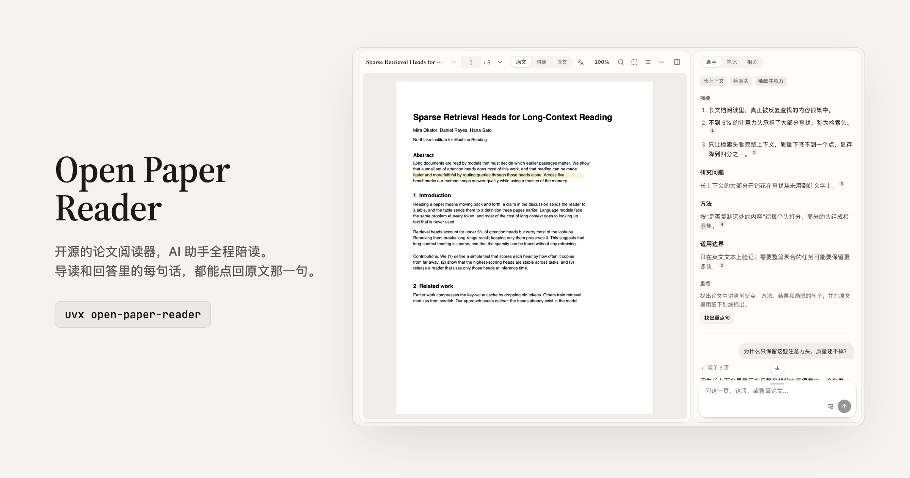

<picture>
  <source media="(prefers-color-scheme: dark)" srcset="docs/assets/banner-dark.png">
  
</picture>

# Open Paper Reader

<p align="center">
  <a href="https://papers.dougao.online"></a>
</p>
<p align="center"><b>打开 <a href="https://papers.dougao.online">papers.dougao.online</a> 就能用，不用安装。</b>想把论文留在自己电脑上，也可以本机运行（见下文）。</p>

**开源的论文阅读器，AI 助手全程陪读。** 导入 PDF、arXiv 或任意论文网址，自动生成导读；划选一句就能解释、翻译、记笔记；有问题直接问助手。导读和回答里的每句话都带出处，点一下回到原文那一句。

简体中文 · [English](README.en.md) · [在线使用](https://papers.dougao.online) · [本机版](docs/LOCAL.md) · [全部文档](docs/README.md)

[](https://github.com/Jialei-03/open-paper-reader/actions/workflows/verify.yml) [](LICENSE)

## 它能做什么

**读**
- **导读**：导入后自动生成摘要、关键词和按章节的说明，边生成边显示。每句话后面有一个小编号，悬停看原文那一句，点一下跳过去并标亮。
- **重点**：自动找出讲创新点、方法、结果和局限的句子，在原文里用细下划线标出，四类可以分别隐藏。
- **划选**：选中文字后可以解释、翻译、高亮、记到笔记，或带着这段话问助手。翻译过的句子会保存下来，再选到同一句直接显示。
- **框选**：在页面上框住一张图、一个表或一个公式，让助手解释，或把公式转成 LaTeX。
- **引用**：悬停正文里的引用，显示被引论文的标题、作者、年份、摘要和引用数，可以预览或一键加入文库。

**问**
- **助手**：实际读取你指的页面或整篇论文来回答，每一步做了什么都可以展开查看；回答同样带逐句出处。你用什么语言问，它就用什么语言答。
- **发送框**：停靠在侧栏的助手里，也可以拖出来浮在论文上方。

**译**
- **对照**：每一页旁边显示这一页的译文。
- **全文译文**，两种方式可选，结果都会保留：
  - **源码重编**：翻译 arXiv 论文的 LaTeX 源码再编译成 PDF，排版最好。编译出错时，助手会读编译报错并尝试修复。
  - **版面翻译**：直接翻译 PDF，保留原版式，任何 PDF 都能用（基于 BabelDOC）。
- **并排看**：原文和译文左右并排，按页码同步滚动。

**整理**
- **笔记**：每篇论文一份 Markdown 笔记，下面列出高亮和批注；导读和回答都能记进来，出处跟着带过去。
- **文库**：带首页缩略图的卡片或列表，按阅读进度、引用数等排序；论文详情里有出处、DOI、引用数，可以复制 BibTeX、APA、GB/T 7714 格式的引用，或批量导出 .bib。
- **相关与发现**：看一篇论文的参考文献和被引用情况；「发现」页根据你的文库推荐论文，并说明为什么推荐。
- **任意网址导入**：首页的导入框接受 arXiv、出版社页面或 PDF 直链；[浏览器扩展](extension/README.md) 可以在网页上一键打开。

## 设计取向

- **本地优先。** 主要装在自己电脑上用，论文和笔记留在本机，不用登录；没有后台抓取，没有遥测。
- **用你自己的模型。** 内置 [Pi](https://github.com/earendil-works/pi) 助手，可以连各家的 API 密钥（OpenAI 兼容、Anthropic 等），也可以连本机模型（Ollama、LM Studio）。
- **引文先核对再显示。** 导读和回答里的每条出处都会在论文原文里查证：页码不对就改正，找不到原句的就不显示，不会指错地方。
- **Claude Code、Codex 还没有接入。** 计划把阅读器的能力（读页、搜索全文、读写笔记）做成 MCP 服务，让你本机的 Claude Code 或 Codex 来读论文；现在的版本里还没有。本项目与 Anthropic、OpenAI 无关联。
- **在线版随时可用。** [papers.dougao.online](https://papers.dougao.online) 不用安装，注册后添加你自己的 API 密钥就能读论文。

## 快速开始

### 在线使用

打开 [papers.dougao.online](https://papers.dougao.online)，注册后在设置里添加模型（你自己的 API 密钥），就可以导入论文。

### 在自己电脑上

```bash
uvx open-paper-reader        # 别名 opr；也可以 pipx install open-paper-reader
```

它会在本机启动服务并打开浏览器，不用登录。第一次打开时先添加一个模型（API 密钥，或 Ollama、LM Studio 这样的本机模型），测试连接通过后就可以导入论文。版面翻译和 LaTeX 编译工具第一次用时在设置里一键安装。论文和笔记存在 `~/.open-paper-reader/`。详见 [本机版](docs/LOCAL.md)。

> 0.2.0 的安装包还没有发布到 PyPI；发布前可以从源码运行（见下文「本地开发」）。

### 浏览器扩展

[`extension/`](extension/README.md) 里有一个 Chrome / Edge 扩展（用「加载已解压的扩展程序」安装）：在网页或 PDF 链接上点工具栏按钮或右键，就在 Open Paper Reader 中打开，在线版和本机版都可以。扩展只发送网址，不读取页面内容。

## 本地开发

```bash
make install   # .venv + 后端、前端、助手运行时的依赖
make db        # 数据库迁移（本机默认 SQLite）
make build     # 构建前端
make run       # http://127.0.0.1:8765
make worker    # 另一个终端：助手 worker（需要 Node.js 22）
make help      # 全部命令
```

目录结构、测试和约定见 [开发](docs/DEVELOPMENT.md)，整体设计见 [架构](docs/ARCHITECTURE.md)。

## 现状与限制

- **模型输出需要你自己核对。** 助手、解释、翻译和导读都是模型生成的；出处会在原文里核对，但这不保证事实或译文的质量。
- **源码重编**依赖论文的 LaTeX 源码能用 XeLaTeX 编译。常见的不兼容会自动处理，编译失败时助手会尝试修复；仍然失败时，可以改用版面翻译。本机版用 Tectonic 编译，个别论文需要的模板文件它没有；在线版用完整的 TeX Live。
- **版面翻译**质量因论文而异，扫描件和公式密集的页面没有专门验收。
- 数据库迁移是单向的：升级之前先备份。

## 隐私

本机版的数据只在你自己的电脑上，作者不会收到。程序只在这些场合访问外部服务：你配置的模型服务（发送完成任务所需的论文内容）、arXiv、Semantic Scholar、OpenAlex、Crossref，以及你主动导入的论文网址。界面里的划选翻译用你配置的模型；后端还保留一个直接调用 API 才会用到的快译接口，它会把文字发到 `translate.googleapis.com`。完整列表见 [架构](docs/ARCHITECTURE.md#对外的网络访问)。

## 参与

欢迎 issue 和 pull request，见 [CONTRIBUTING](CONTRIBUTING.md)。安全问题请按 [SECURITY](SECURITY.md) 私下报告。

## 许可证

[MIT](LICENSE)。第三方组件的许可证见 [NOTICE](NOTICE.md)；版面翻译用到的 BabelDOC 是 AGPL-3.0，只在需要时单独安装，或存在于可选的、单独构建的镜像里。

站在这些项目的肩膀上：[PDF.js](https://github.com/mozilla/pdf.js)、[Pi](https://github.com/earendil-works/pi)、[BabelDOC](https://github.com/funstory-ai/BabelDOC)、[LaTeXTrans](https://github.com/NiuTrans/LaTeXTrans)、[Tectonic](https://tectonic-typesetting.github.io)、[TipTap](https://tiptap.dev)、[KaTeX](https://katex.org)、[FastAPI](https://fastapi.tiangolo.com)、[SQLAlchemy](https://www.sqlalchemy.org)。
