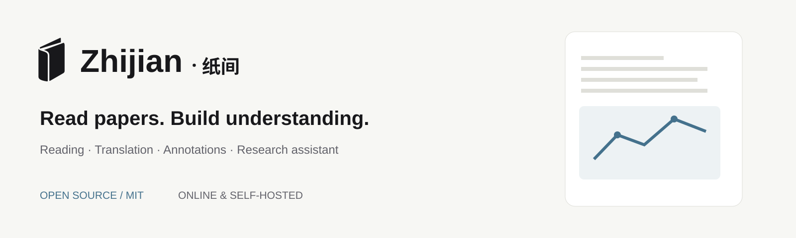
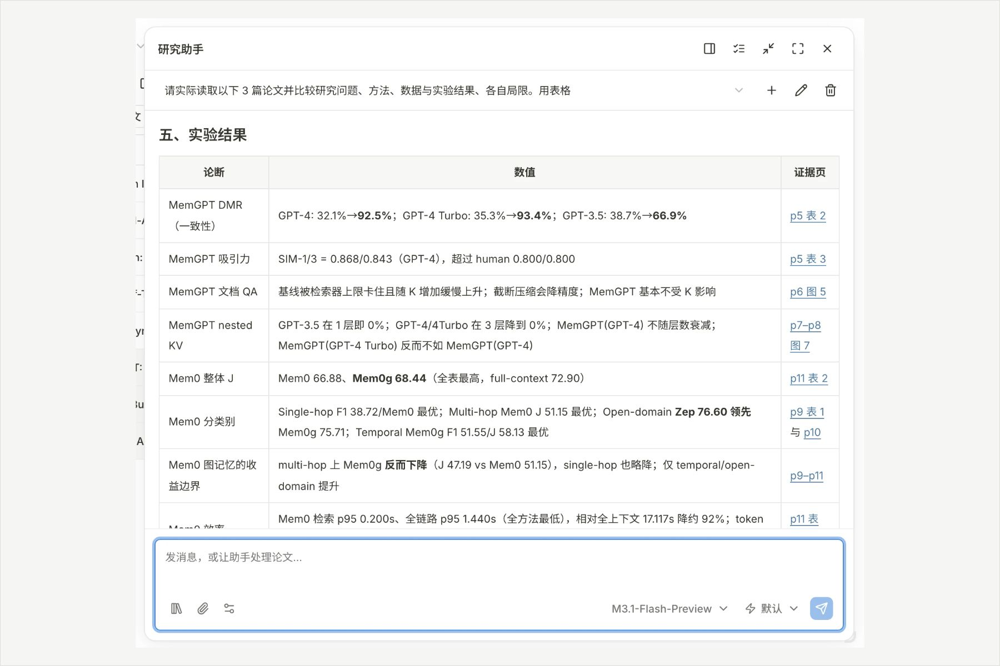
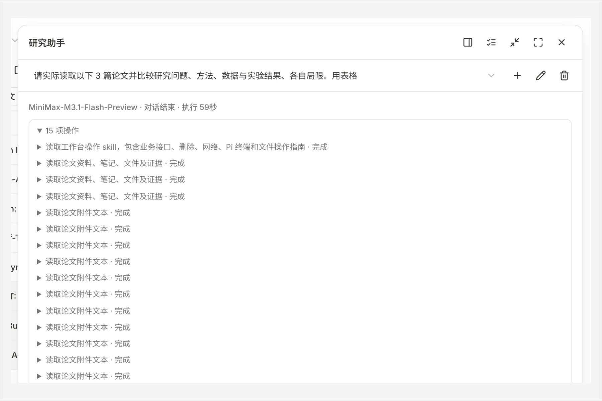
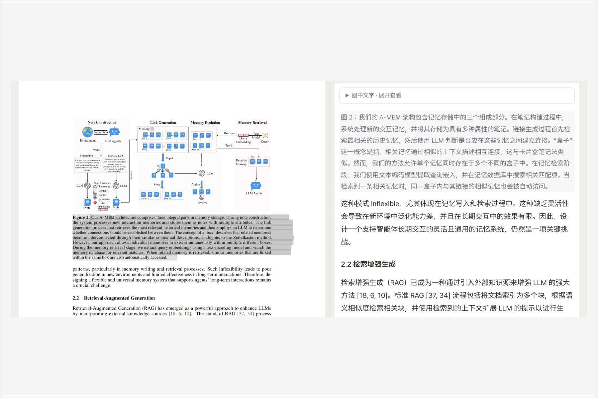
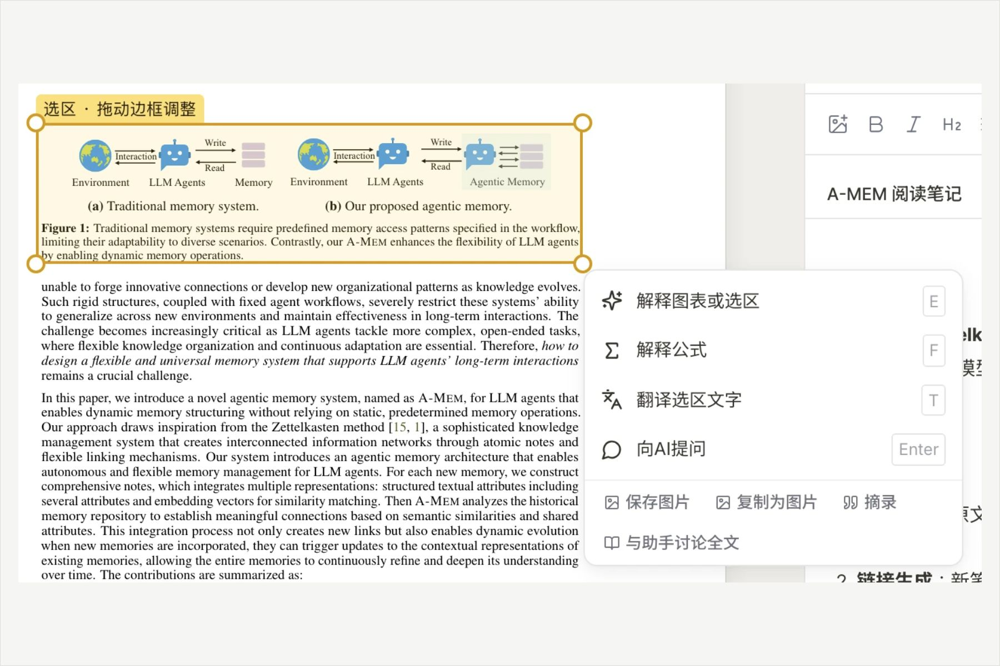

<p align="center"></p>

<h1 align="center">纸间 · Zhijian</h1>

<p align="center"><strong>开源的论文阅读工作台，助手全程参与。</strong></p>

<p align="center">
在一个窗口里读论文、翻译、批注、写笔记。研究助手实际读取原文，结论带着页码，能跨论文比较，也能动手整理，做过什么都可以核对。<br>
纸间采用 MIT 许可证，既可直接使用维护者提供的在线服务，也可自行部署。欢迎一起改进阅读体验、模型接入和研究工作流。
</p>

<p align="center"><a href="https://papers.dougao.online">在线使用</a> · <a href="docs/DEPLOYMENT.md">自行部署</a> · <a href="CONTRIBUTING.md">参与共创</a></p>

> 当前仓库暂时保持私有，公开时间由维护者决定；线上服务持续提供。

<p align="center">
  <a href="https://github.com/Jialei-03/zhijian/actions/workflows/verify.yml"></a>
  <a href="LICENSE"></a>
</p>

<p align="center">
  简体中文 · <a href="README.en.md">English</a> · <a href="docs/DEPLOYMENT.md">部署</a> · <a href="docs/FEATURES.md">功能</a> · <a href="docs/README.md">全部文档</a>
</p>

| | |
| --- | --- |
| <br>**助手读过原文，再回答。** 勾选几篇论文，它逐篇读取全文，按研究问题、方法、数据、结果与局限整理成表，每一项标明出自哪一页。 | <br>**做过什么，一目了然。** 每个回答都可以展开「N 项操作」，看到它读了哪几份文件、做了哪些修改；写入之后回读核对，并给出可点开的凭证。 |
| <br>**逐句对照翻译。** 译文以论文的文字层为准，悬停一句译文，原文里对应的那一句亮起。 | <br>**指哪里，问哪里。** 选中文字或框住图表、公式、表格，解释、翻译、提问、摘录都在手边。 |

## 纸间是什么

读论文往往要在好几个工具之间来回切换：PDF 阅读器、翻译、批注、笔记、文献管理，再加一个聊天窗口。纸间把它们放进同一个工作区，并且让助手站在你读到的那一页上，而不是对着一份没有出处的摘要聊天。

- **研究助手**：实际读取你指的那一页、那个区域或整篇论文；回答带页码，看不清、没读到的会直说。能比较多篇论文，能写入笔记、打标签、导入 arXiv 论文、发起翻译；修改文库默认需要你允许。
- **读与译**：连续滚动或翻页的阅读器，目录、缩略图、全文查找；选中即解释、翻译、高亮、评论、提问；整篇逐句对照翻译，提供 LaTeX 源码的 arXiv 论文还可以译成排版完整的中文 PDF。
- **批注与笔记**：五色高亮、原文评论、手写笔；Markdown 笔记，支持公式、图片、表格，历史可回看；笔记与论文之间的链接自动形成双向链接和知识图谱。
- **文库**：状态、标签、研究方向、集合、批量整理，全局搜索（`⌘K`），按研究方向发现新论文，只读分享链接，一键导出。
- **自己部署**：一条 `docker compose up` 起一套完整的服务（API、助手 worker、PostgreSQL）。每个账户独立空间；模型密钥只在服务器上；没有后台抓取，也没有遥测。
- **不接模型也能用**：导入、阅读、批注、笔记、文库不需要模型；只有解释、翻译、导读、测验和助手需要。

完整的功能清单见 [功能](docs/FEATURES.md)。

## 快速开始

需要 Docker 和 Compose v2.24 或更新（`docker compose version` 查看）、约 2 GB 空闲内存。

```bash
git clone https://github.com/Jialei-03/zhijian.git
cd zhijian
cp .env.example .env
# 把 POSTGRES_PASSWORD 换成一串随机的字母数字：
sed -i "s/^POSTGRES_PASSWORD=.*/POSTGRES_PASSWORD=$(openssl rand -hex 24)/" .env    # macOS 用 sed -i ''
docker compose up -d --build
```

打开 <http://localhost:8765>，注册第一个账户，然后在「设置 → 模型」里添加你的模型（OpenAI 兼容或 Anthropic 协议）。

- 想让陌生人不能注册、只让受邀的人使用：`.env` 里设 `REGISTRATION=invite`，并在注册之前用 `docker compose exec web python -m backend.cli bootstrap --username admin` 创建管理员。
- 要放到公网上：前面放一个终止 TLS 的反向代理（仓库里有 Caddy 和 nginx 的示例），设 `APP_ENV=production` 和 HTTPS 的 `APP_ORIGIN`。步骤、升级、备份和排障见 [部署](docs/DEPLOYMENT.md)。
- 不用 Docker，直接装在一台 Linux 机器上（systemd 单元已备好）：见 [部署](docs/DEPLOYMENT.md#二原生安装systemd)。

### 连接模型

每个账户可以添加自己的模型，部署者也可以提供一个所有账户共享的模型（见 [配置](docs/CONFIGURATION.md#模型)）。出于安全，服务器只向 **HTTPS、443 端口、公网地址、且主机名在名单里** 的服务发请求，名单里有 OpenAI、Anthropic、DeepSeek、OpenRouter、Google AI Studio、SiliconFlow 和 MiniMax；其他兼容服务把主机名加进 `TRANSLATION_ALLOWED_HOSTS`。目前**不支持** http 地址或内网地址（例如本机的 Ollama）。

## 本地开发

```bash
make install   # .venv + 后端、前端、助手运行时的依赖
make db        # 数据库迁移（本机默认 SQLite）
make build     # 构建前端
make run       # http://127.0.0.1:8765
make worker    # 另一个终端：助手 worker（需要 Node.js 22）
make help      # 全部命令：test、check、e2e、web（前端热更新）……
```

目录结构、测试和约定见 [开发](docs/DEVELOPMENT.md)，整体设计见 [架构](docs/ARCHITECTURE.md)。

## 文档

| | |
| --- | --- |
| [功能](docs/FEATURES.md) | 纸间能做什么，哪些需要模型 |
| [部署](docs/DEPLOYMENT.md)、[配置](docs/CONFIGURATION.md) | Docker Compose 与原生安装；全部环境变量；可选组件 |
| [运维](docs/OPERATIONS.md)、[运维恢复](docs/OPERATIONS-RECOVERY.md) | 迁移、备份与恢复、安全边界 |
| [助手](docs/AGENT.md)、[翻译](docs/TRANSLATION.md)、[性能](docs/PERFORMANCE.md) | 研究助手的工作方式与边界；四条翻译路径；思考强度与速度的实测 |
| [架构](docs/ARCHITECTURE.md)、[API](docs/API.md)、[开发](docs/DEVELOPMENT.md) | 进程与数据模型、对外 API、开发手册 |

## 现状与限制

纸间已经可以日常使用，但还年轻，有这些事要提前知道：

- **界面只有简体中文**，翻译的目标语言也只有简体中文。论文和模型的输出可以是任何语言。
- **模型输出需要你自己核对。** 助手、解释、翻译、导读和测验都是模型生成的；服务端会校验引文确实出自原文，但这不保证事实或译文的质量。
- **单机部署。** 登录限流在进程内，共享模型的并发限制用本机文件锁，所以只运行一个 web 进程。多机部署需要先在边缘加共享限流。
- **普通 PDF 的版面翻译是实验性的**：质量因论文而异，扫描件和公式密集的页面没有验收。整篇翻译只支持提供 LaTeX 源码的 arXiv 论文。
- **助手的代码执行**需要单独部署一个沙箱 broker；不部署时，这些工具明确报告不可用，不会退回到宿主机上执行。
- 数据库迁移是单向的：升级之前先备份，回滚靠恢复备份。

## 隐私

数据在你的服务器上，纸间不会把它发给纸间的作者。服务器只在这些场合主动访问外部服务，没有后台抓取：你配置的模型服务（发送完成任务所需的论文内容）、划选后点「翻译」的快译（发送选中的文字到 `translate.googleapis.com`，不想用就在防火墙上拦掉，AI 精译不受影响）、arXiv、Semantic Scholar（只发送论文公开的 DOI 或 arXiv 编号）、Crossref，以及你配置的 SMTP。完整列表见[架构](docs/ARCHITECTURE.md#对外的网络访问)。

## 参与

欢迎 issue 和 pull request，流程见 [CONTRIBUTING](CONTRIBUTING.md)。发现安全问题请按 [SECURITY](SECURITY.md) 私下报告，不要公开提 issue。

## 许可证

[MIT](LICENSE)。第三方组件各自的许可证见 [NOTICE](NOTICE.md)，其中版面翻译用到的 BabelDOC 是 AGPL-3.0，它只存在于可选的、单独构建的镜像里。

纸间站在这些项目的肩膀上：[PDF.js](https://github.com/mozilla/pdf.js)、[Pi](https://github.com/earendil-works/pi)、[BabelDOC](https://github.com/funstory-ai/BabelDOC)、[LaTeXTrans](https://github.com/NiuTrans/LaTeXTrans)、[shadcn/ui](https://ui.shadcn.com)、[Radix](https://www.radix-ui.com)、[TipTap](https://tiptap.dev)、[KaTeX](https://katex.org)、[FastAPI](https://fastapi.tiangolo.com)、[SQLAlchemy](https://www.sqlalchemy.org)。
