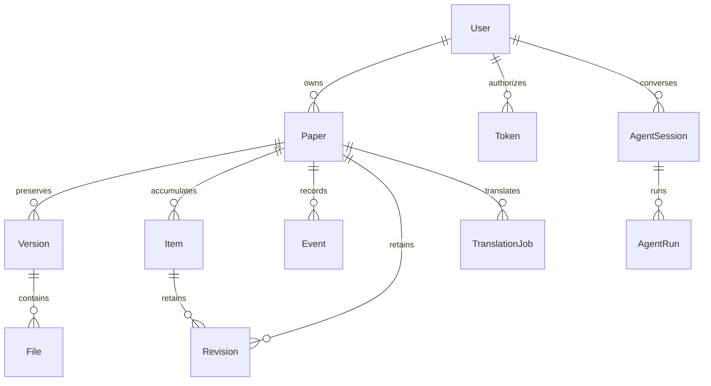

# 架构与安全边界

## 进程与模块

```
浏览器 ──HTTPS──▶ 反向代理 ──▶ web（FastAPI，一个进程：API + 已构建的前端）
                                 │
                 ┌───────────────┼──────────────────┐
                 ▼               ▼                  ▼
            PostgreSQL      文件存储目录        私有配置目录
         （SQLite 仅本机）  （论文、图片、附件）  （模型密钥，0700/0600）
                 ▲
                 │ 领取任务
   ┌─────────────┴───────────────────────────────────────┐
   │ agent worker（Python）── stdin/stdout ──▶ Node 研究助手 │──▶ 沙箱 broker ──▶ 一次性容器
   │ translation worker（可选，用 Docker）──▶ TeX / 版面翻译容器 │
   └──────────────────────────────────────────────────────┘
```

| 位置 | 职责 |
| --- | --- |
| `backend/main.py` | FastAPI v1 路由、会话与令牌鉴权、请求大小限制、归属检查、并发控制、幂等、安全的文件下发 |
| `backend/models.py`、`schemas.py` | SQLAlchemy 持久化模型；严格的 Pydantic 请求结构（未知字段一律拒绝） |
| `backend/migrations/` | Alembic。`0001_initial.py` 是写死的建表语句，不随模型改动 |
| `backend/agents.py`、`agent_worker.py`、`agent_tools.py` | 助手的控制面、worker 调度、工具定义与执行；Python 持有凭据和业务权限，Node 只做模型对话和工具调用的循环 |
| `backend/direct_runs.py`、`reading_artifacts.py` | 固定任务（逐页翻译、导读、测验、目录、重点建议）：一次输入、一次模型调用、检查结果，不走助手循环；写入的会话与阅读产物和助手路径是同一种记录 |
| `backend/translation_engine.py`、`translation_worker.py`、`pdf_layout_jobs.py` | 整篇翻译：LaTeX 源码路径与版面翻译路径。**网页请求不会运行 TeX**，只有 worker 会 |
| `backend/media.py`、`pdf_structure.py` | 受资源限制的 PDF/图片检查进程；图表与公式识别（可选） |
| `backend/platform_model.py`、`translation_settings.py`、`model_usage.py` | 共享模型、账户自己的模型、用量与每日预算 |
| `backend/discovery.py`、`citations.py`、`link_preview.py` | 按需访问外部服务：arXiv、Semantic Scholar、Crossref、公开链接卡片 |
| `backend/ops_backup.py`、`cli.py` | 离线的管理员初始化、备份与校验恢复、加密恢复包 |
| `agent-runtime/` | 助手的 Node 运行时（[Pi](https://github.com/earendil-works/pi)）；`skills/` 是写给模型的操作说明 |
| `frontend/src` | React/TypeScript 界面，同源请求；不持有模型密钥和管理凭据 |
| `deploy/` | Dockerfile、systemd 单元、反向代理示例、沙箱 broker、备份脚本 |

开发时各部分怎么跑、代码在哪里，见 [开发](DEVELOPMENT.md)。

## 数据模型



每个私有对象都有所有者。所有者由请求的凭据决定，没有调用方可以控制的 `workspace_id`。查询和所有外键引用都用这个身份检查；别人的 ID 在列表、详情、修改、内容、下载、历史和上下文里一律返回 404。导出总是限定在所有者范围内。Agent 凭据只属于一个用户，即使这个用户是管理员。

- **论文与版本**：`Paper` 有标题、作者、摘要、标签、阅读状态、收藏、归档；`Version` 是论文的一个版本（例如 arXiv 的 v2）；`File` 是不可变的、以 UUID 寻址的文件，带 SHA-256、检测出的 MIME、大小、论文与版本。新版本不会改动旧版本上的定位。
- **笔记与记录**：`Item` 的 `kind` 区分 `note`、`evidence`、`analysis`、`question`、`topic`、`link`；专题和链接存放经过所有者校验的论文/证据引用，证据必须带定位（PDF 页、源码行区间、图表标签或原文引文）。
- **版本号与历史**：可编辑的论文和 `Item` 用整数 `revision`，借助 SQLAlchemy 的版本感知 UPDATE 条件，即使两个请求同时读到同一个版本也会拒绝后写的那个；写入需要 `If-Match`。每次成功的修改都保留不可变的快照和操作者。删除是显式的，并清除该对象的历史；删除一篇论文会同时删除它的文件和论文内的记录。文件没有单独的修改或删除接口，以保证引用完整，删除论文是唯一的出口。
- **阅读状态**：`Paper.agent_status` 与 `Paper.reading_status` 相互独立。用户改变阅读状态需要人的会话并写入事件；助手只能追加未经确认的建议。打开一个文件不代表读完。
- **批注**：高亮、评论、手写笔画分开存放，不覆盖原 PDF；导出带批注的 PDF 时才在受限进程里渲染。
- **任务**：`AgentRun` / `AgentSession` 记录助手与固定任务的运行；`TranslationJob` 记录整篇翻译与它的检查点；`ReadingArtifact` 是导读、测验、重点建议这类带版本的阅读产物；`ModelUsage` 记录模型请求数与上游返回的用量。

## 认证与内容安全

- 密码用 Argon2id。会话值、CSRF 令牌、邀请码和 Agent 凭据都以高熵随机值的 SHA-256 摘要保存；Agent 凭据有明确的过期时间并可撤销，原始值只在创建时显示一次；恢复备份会让会话、邀请码和令牌全部失效。会话有效期 7 天。
- 登录相关接口按来源 IP 限流（每个进程每 15 分钟 30 次），所以只运行一个 web 进程；需要多进程时先在边缘加共享限流。
- Cookie：会话是 `HttpOnly`、`SameSite=Strict`，生产环境要求 `Secure` 与 HTTPS；可读的 CSRF Cookie 必须回填到 `X-CSRF-Token`，对每个 Cookie 鉴权的写请求都与会话里的摘要比对；带着不受信任 `Origin` 的写请求被拒绝；不开放跨源 CORS。密钥不接受出现在 URL 查询参数里，也不放进浏览器存储。日志里不打印请求正文和凭据。
- 上传在解析之前就限制大小（包括分块请求），再按单个文件限制（默认 50 MiB）；JSON 请求限制 2 MiB。文件名和源路径拒绝绝对路径、`..`、反斜杠、控制字符和盘符；磁盘上用生成的 UUID 命名；独占创建、权限 0600；读取时拒绝符号链接，存储目录本身也不能是符号链接。
- PDF 和图片在固定的、受资源限制的子进程里检查（Linux 下 768 MiB 地址空间、10 CPU 秒、15 秒墙钟，最多 3000 页、4000 万像素），不执行文档里的任何脚本。PDF.js 关闭 eval，只画 canvas；PDF 动作、表单和脚本不对外暴露。Markdown 去掉原始 HTML 和不安全链接，禁用外部图片以避免追踪；文本和 LaTeX 按文本显示；HTML/SVG/Office/压缩包从不内联或执行，未知格式要求 `download=true` 并用 `application/octet-stream` 与安全的附件头。
- 响应带 `no-store`、`nosniff`、禁止嵌入、严格的 CSP，生产环境加 HSTS；Swagger 资源在本地，遵循同一套策略。
- arXiv 的 LaTeX 源码包在写入磁盘之前先检查：最多 3000 个条目、150 MiB，拒绝链接、设备文件、路径穿越和重复路径；编译只在一次性的容器里。
- **没有**：在宿主机上执行命令的接口、会执行文档内容的处理、公开的论文路由（分享链接是显式的、可撤销的只读链接）、共享的内容缓存（`/api` 的响应一律不缓存，只有按内容命名的静态资源可以长期缓存）、任意 URL 的抓取（助手的网络工具除外，见下）。反向代理不要加共享缓存。

### 对外的网络访问

服务器只在这些场合主动访问外部服务，没有后台抓取：

| 目的地 | 何时 | 发送什么 |
| --- | --- | --- |
| 你配置的模型服务 | 助手、翻译、导读等 | 为完成任务需要的论文内容和你的提问；只允许 HTTPS、443、白名单主机、公网地址，不跟随重定向 |
| `translate.googleapis.com` | 划选后点「翻译」的快译 | 选中的那段文字 |
| arXiv | 导入 arXiv 论文、发现论文、下载 LaTeX 源码 | 论文编号或搜索词 |
| Semantic Scholar | 阅读器里查看参考文献与被引用 | 论文公开的 DOI 或 arXiv 标识 |
| Crossref | 助手的「搜索论文」工具 | 搜索词 |
| 公开网页 | 助手的 `web_read` / `download_file`、链接悬停卡片 | 链接地址；连接前校验全部 DNS 结果并固定到公网 IP，逐跳检查重定向 |
| SMTP | 找回账号邮件（需要你配置） | 收件地址与邮件内容 |

## 助手的边界

模型和工具的循环在 Node 里，但所有数据访问和凭据都在 Python 一侧：Node 没有 HTTP 服务，工具调用通过标准输入输出回到 Python，由 Python 以当前用户的身份调用同一套业务接口，所有权检查、版本冲突检查和幂等和人用界面时完全一样。助手能做的写操作要求你打开「允许修改文库」，服务端再检查一遍。代码执行只在沙箱容器里，没有 broker 时不会退回宿主机。细节见 [助手](AGENT.md)。

## 规模与已知限制

- 登录限流在进程内、元数据以整张列表返回、文件放本地磁盘，这些都面向个人和小团队的私有实例。
- 备份与恢复是离线的，不是在线复制；生产存储的加密和异地备份由运维负责。导出的内容和原文件有相同的权限，要当作私有数据。
- 共享模型的并发限制用本机文件锁，多台机器要换成分布式限流。
- 界面目前只有简体中文，翻译的目标语言也只有简体中文。
- 不做语义搜索、扫描件的独立 OCR、多人协作编辑、Office 文件预览。
